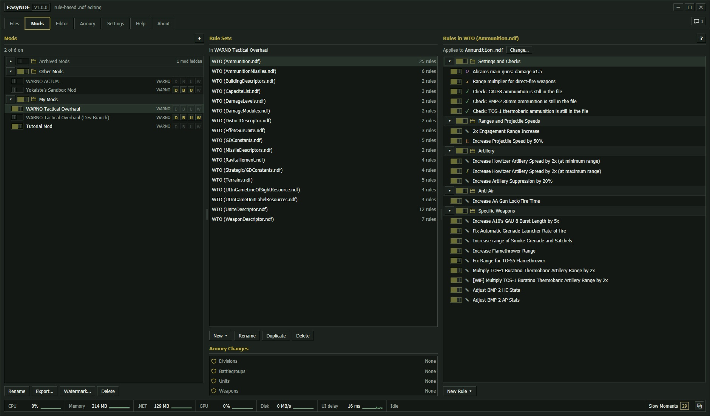
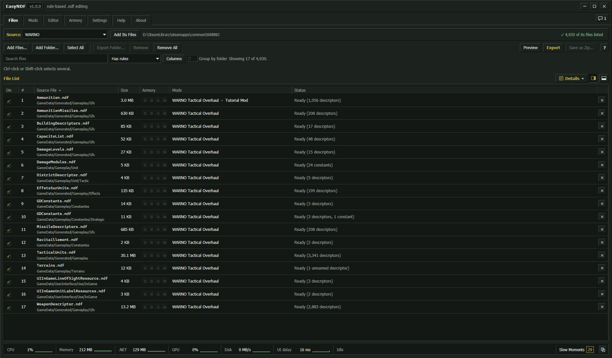
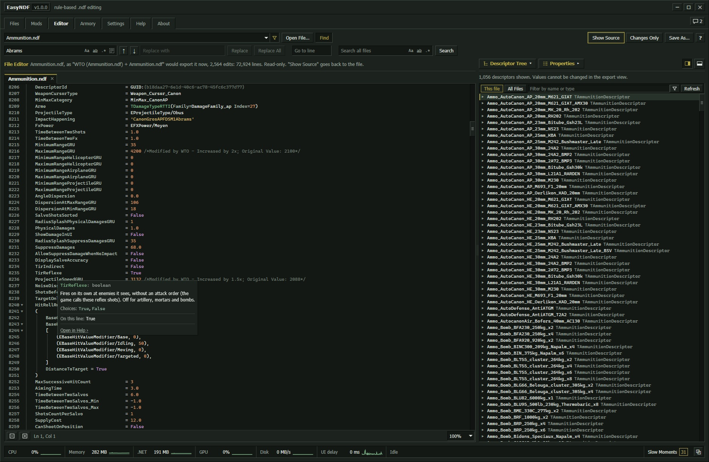
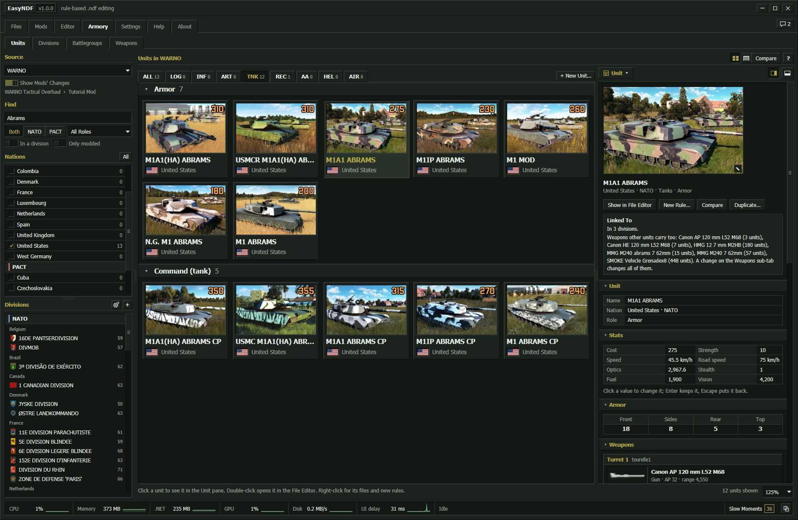
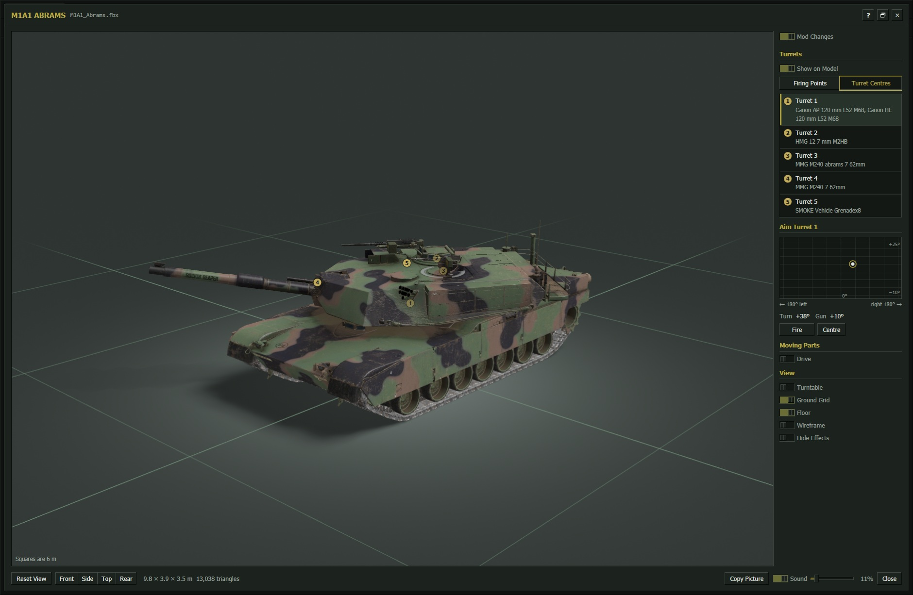
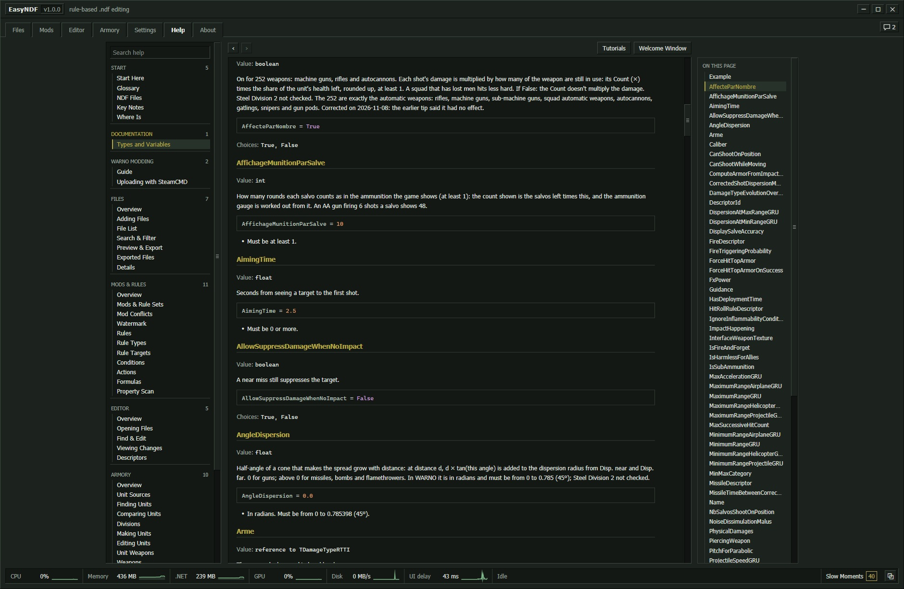

# EasyNDF

A rule-based editor for **WARNO** and **Steel Division 2** `.ndf` files, designed to make repetitive edits easier.

**[Download the latest version](https://github.com/ShadowofChernobyl/EasyNDF/releases/latest)** or **[try the online demo](https://shadowofchernobyl.github.io/EasyNDF-HTML-Demo/)** · Windows 10 or 11 (64-bit) · Free and open source

Also please feel free to join the **[Discord Server](https://discord.com/invite/BZbRjgxr5b)**

Instead of hand-editing the same fields over and over, you:

- add one or more `.ndf` files, or a whole folder of them
- define one or more **rules**
- give each rule one or more **conditions**
- apply one or more **actions** when those conditions match
- export the rewritten files
- save your rules as rule sets, and your rule sets as a mod, to use again later

Your files stay on your computer. Nothing is uploaded, and your original files are never changed.

## Download

On the [latest release](https://github.com/ShadowofChernobyl/EasyNDF/releases/latest), download one:

- **[EasyNDF-Setup.exe](https://github.com/ShadowofChernobyl/EasyNDF/releases/latest/download/EasyNDF-Setup.exe)** installs EasyNDF for your Windows account, with Start menu and desktop shortcuts. It checks for new versions when it starts and asks before updating.
- **[EasyNDF-Portable.exe](https://github.com/ShadowofChernobyl/EasyNDF/releases/latest/download/EasyNDF-Portable.exe)** is a single file you can run from anywhere, with nothing to install. It doesn't update itself.

Both keep your mods and settings in the same place, so you can switch between them. The first time, your browser or Windows may warn that the file isn't commonly downloaded: choose **Keep** (or **More info**, then **Run anyway**).

## A Look Around

### Files

Add a game's files, a folder of them, or a `.zip` or `.rar`. Each file shows which mods change it and how much it holds; **Preview** shows the changes before anything is written, and **Export** writes the edited copies.

### Mods

A mod holds rule sets, and each rule set holds rules, sorted into folders (pictured at the top). Each rule can be switched on or off, and mods made by others can be imported and combined with your own.

### Editor

Open any file to read it as it would export with your mods' changes, and find, replace or compare across files. Point at a name to see what it does and the values it takes, and browse each file's descriptors in the tree on the right.

### Armory

Browse every unit, division, battlegroup and weapon, with or without your mods' changes. Compare units, change their values directly, or make new units and divisions.

A unit's 3D model can be viewed with its turrets, firing points and moving parts.

### Help

Guides to every tab, a tutorial that makes a small mod with you, and Documentation for every type and variable in the `.ndf` files. Press **F1** in the Editor to open the page of the name under the caret.

## What It Is Not

- Not a general-purpose text editor.
- Not a tool for creating or modifying assets or models. You'll want Blender for that.
- Not a mod manager.

## Who Made It

EasyNDF is made by **ShadowofChernobyl**. Discord: `ShadowofChernobyl#0720`

EasyNDF is free software under the GNU Affero General Public License, version 3. Forks may not call themselves EasyNDF or suggest that they are.

Despite the name, ShadowofChernobyl is not involved with GSC Game World or any of its products.

## Credits and Special Thanks

- **Yokaiste**, for creating YSM and YMB.
- **Chinofchrist**, for creating the mod that inspired me to make my own.
- **etouf fement (CHO KING)**, for creating A World in Flames and allowing me to combine my mods with theirs.
- **Matthew Smith**, for designing the AST, parser and writer of the original EasyNDF.

## Software Credits

- The Editor is built on [AvalonEdit](https://github.com/icsharpcode/AvalonEdit) by the SharpDevelop Team, used under the MIT License.
- `.rar` files are read with [SharpCompress](https://github.com/adamhathcock/sharpcompress) by Adam Hathcock, which includes code from [Bouncy Castle](https://www.bouncycastle.org), both under the MIT License.
- The games' textures are unpacked with [ZstdSharp](https://github.com/oleg-st/ZstdSharp) by Oleg Stepanischev, under the MIT License, a port of [Zstandard](https://github.com/facebook/zstd) by Meta, under the BSD License.
- The "Hot beverage" and "Pushpin" emoji are from [Fluent Emoji](https://github.com/microsoft/fluentui-emoji) by Microsoft, used under the MIT License.
- The 3D model viewer draws with [Vortice.Windows](https://github.com/amerkoleci/Vortice.Windows) and [Vortice.Mathematics](https://github.com/amerkoleci/Vortice.Mathematics) by Amer Koleci, which use [SharpGen.Runtime](https://github.com/SharpGenTools/SharpGenTools), all under the MIT License.
- Its sounds are played with [NAudio](https://github.com/naudio/NAudio) by Mark Heath, under the MIT License, and unpacked from the game's files the way [wgrd-cons-tools](https://github.com/ev1313/wgrd-cons-tools) by ev1313 does, under the GNU Affero General Public License, version 3.
- Their licenses are in [THIRD-PARTY-NOTICES.txt](THIRD-PARTY-NOTICES.txt), and in the app under About › License.

## Theme Credits

- **Monokai** is based on the Monokai color scheme created by Wimer Hazenberg.
- **Mariana** is based on the Mariana color scheme that ships with Sublime Text.
- **Solarized Dark** and **Solarized Light** are based on the Solarized palette by Ethan Schoonover.
- **Dark** is the Light theme converted with the color rules of the Dark Reader browser extension.
- Some colors in each were adjusted for readability in this tool. EasyNDF is not affiliated with, or endorsed by, any of the above.

## Useful Links

**Discord servers:** [Eugen Systems Official](https://discord.com/invite/pv9VAcN) · [YSM Community](https://discord.gg/XmbhaSRqfZ) · [A World In Flames Community](https://discord.gg/3FsfYNKpZe)

**Steam Workshop:** [WARNO Tactical Overhaul](https://steamcommunity.com/sharedfiles/filedetails/?id=3387658237) · [YSM x WiF x WTO](https://steamcommunity.com/sharedfiles/filedetails/?id=3554281691) · [Yokaiste's Sandbox Mod](https://steamcommunity.com/sharedfiles/filedetails/?id=3296415395) · [A World in Flames](https://steamcommunity.com/sharedfiles/filedetails/?id=3388575848)

**More:** [WARNO Wiki](https://waryes.com/) · [Tank Encyclopedia](https://tanks-encyclopedia.com/) · [Eugen Systems Official Website](https://www.eugensystems.com/)

---

## For Developers

EasyNDF is a C# WPF app on .NET 10. The earlier WinForms app is kept on the [`archive/winforms`](https://github.com/ShadowofChernobyl/EasyNDF/tree/archive/winforms) branch, and the HTML version runs in the browser: <https://shadowofchernobyl.github.io/EasyNDF-HTML-Demo/>

### Building

You need **Visual Studio 2026** (Community is free) with the **.NET desktop development** workload, or the **.NET 10 SDK** on its own.

- In Visual Studio: open `EasyNDF.slnx`, then **Build > Build Solution**.
- From a command line: `dotnet build EasyNDF.slnx`

### What Is Where

| Folder | What |
|---|---|
| `src/EasyNdf.Engine` | The rule engine: reads NDF, runs rules, writes the exported file. It has no user interface. See its [README](src/EasyNdf.Engine/README.md). |
| `src/EasyNdf.Data` | Where the app keeps its data (Local AppData or portable), and the mod, theme, filter and language pack files. See its [README](src/EasyNdf.Data/README.md). |
| `src/EasyNdf.App` | The WPF app itself. |

### The App's Texts and Languages

Every text the app shows has a fixed name, such as `Files.AddFolder`, and its English is in `src/EasyNdf.App/Languages/en`, one file per part of the app (`files.json`, `rules.json`, `settings.json`...). French, German, Russian and Chinese come with the app (`fr.json`, `de.json`, `ru.json`, `zh.json`).

- **In a screen (XAML):** `Content="{t:Text Files.AddFolder}"`, with `xmlns:t="clr-namespace:EasyNdf.App.Text"` at the top of the file.
- **In code:** `Texts.Get("Files.AddFolder")`. A text with blanks: `"Delete \"{name}\"?"` and `Texts.Get("Rules.DeleteAsk", ("name", rule.Name))`. A text that depends on a number lists its forms with `|`: `"{count} edit|{count} edits"` and `Texts.Count("Files.Edits", 5)`.
- **Bold or code inside a sentence:** `**bold**` and `` `code` ``, shown with `t:RichText.Markup="{t:Text Welcome.Intro}"` on a TextBlock.
- **To add a text:** add its name and English to the right file, then use the name. Rewording the English later never loses a translation: packs remember which English they were made from, and count the text as "to check".
- **The Help wiki and the About tab** stay as HTML (`src/EasyNdf.App/Help/wiki.json` and `about.html`); each page's title and HTML, and each group, are texts too (`Help.Page.start.Title`, `Help.Page.start.Html`, `Help.Group.GettingStarted`, `About.Page.Html`), so packs translate them like the rest. The change log is one text per version (`Help.ChangeLog.1.0.1.Html`), so a new version is the only part to translate.
- **Numbers:** `Texts.Number(1234)` writes "1,234" with the language's separators; `Texts.CountWide` is `Texts.Count` with the number written that way.
- Other languages are packs imported on the Settings tab (Language card). **Export** gives a file with every text to translate; whatever a pack lacks shows in English.

### Mods Made in Other Versions

Mod files keep the HTML app's format (`FormatVersion: 1`), so mods made in the HTML app open here unchanged. Plain Edit rules are also the format of the WinForms app.

### Test Switches

For a PC that draws the app oddly: `--render software` draws without the graphics card, and `--frame native` uses Windows' own title bar and frame instead of the app's. In Visual Studio, set them under **Debug > EasyNdf.App Debug Properties > Command line arguments**.

### License

EasyNDF is free software under the [GNU Affero General Public License, version 3](LICENSE.txt), with two additional terms (section 7): forks may not call themselves EasyNDF or suggest that they are, and modified versions must be marked as different from the original. The code it includes from others is under the MIT and BSD licences, and the way it unpacks the game's sounds follows wgrd-cons-tools, under the GNU AGPL v3 like EasyNDF (see [THIRD-PARTY-NOTICES.txt](THIRD-PARTY-NOTICES.txt)).

"ShadowofChernobyl" is the author's user name. Despite it, the author is not involved with GSC Game World or any of its products.
